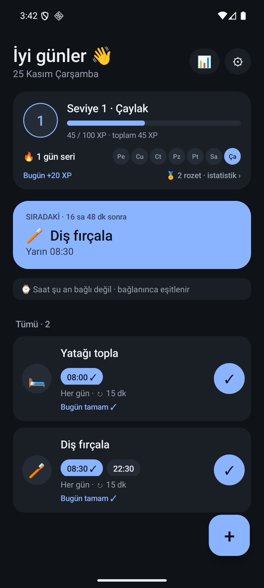
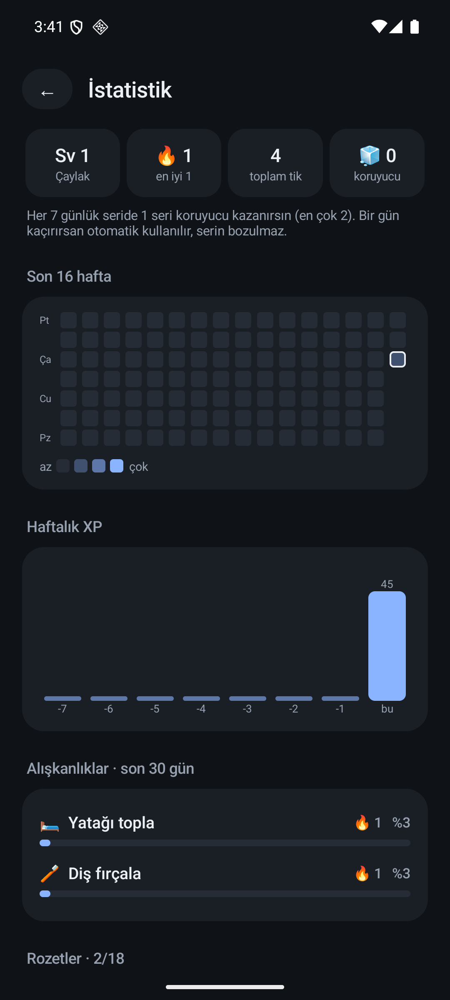
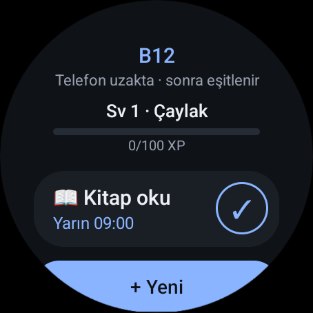

<h1 align="center">🔔 B12</h1>

<p align="center">Telefon ve <b>Galaxy Watch</b> için kalıcı hatırlatma ve alışkanlık uygulaması.<br>
Yatağı topla, diş fırçala, 1 saat kitap oku… Yaptıkça XP kazan, seviye atla, serini koru.</p>

<p align="center"><b><a href="CHANGELOG.md">📋 Sürümlerde neler var?</a></b></p>

<p align="center">
  
  
  
</p>

## İndir ve kur

### [⬇ B12-telefon.apk'yı indir](https://github.com/Sefikak/B12/releases/latest/download/B12-telefon.apk)

1. APK'yı telefona indirip aç. Telefon sorarsa **bilinmeyen kaynaktan kurma** iznini ver.
2. İlk açılışta bildirim iznini ver.
3. Samsung'da uygulamadaki **"Kısıtlamayı kaldır"** uyarısına dokun; yoksa pil tasarrufu hatırlatmaları geciktirebilir.

**Gereksinimler:** Android 8.0 veya üstü.

### [⬇ B12-saat.apk'yı indir](https://github.com/Sefikak/B12/releases/latest/download/B12-saat.apk) (Galaxy Watch / Wear OS)

Saat APK'yı kendisi açamadığı için bir kereliğine bilgisayardan Wi-Fi üzerinden kurulur:

1. Saatte: **Ayarlar → Saat hakkında → Yazılım → Yazılım sürümü**'ne 5 kez dokun (Geliştirici seçenekleri açılır).
2. **Ayarlar → Geliştirici seçenekleri**: **ADB hata ayıklama** ve **Kablosuz hata ayıklama**'yı aç. Saat ve bilgisayar aynı Wi-Fi'da olmalı.
3. **Kablosuz hata ayıklama → Yeni cihaz eşle**: ekrandaki adres ve 6 haneli kodla bilgisayarda:
   ```
   adb pair IP:PORT KOD
   adb connect IP:PORT        (Kablosuz hata ayıklama ekranındaki ana adres)
   adb install -r B12-saat.apk
   ```
   `adb`, [Android SDK Platform Tools](https://developer.android.com/tools/releases/platform-tools) içinde gelir.

**Gereksinimler:** Wear OS 3 veya üstü (Galaxy Watch4 ve sonrası). Telefon ve saat uygulaması aynı sürümden olmalı.

> Telefon ve saat birbirini **Bluetooth üzerinden** bulur; internet ya da hesap gerekmez.

## Özellikler

### Hatırlatmalar
- **Kalıcı hatırlatmalar:** ad, gün, günde istediğin kadar saat. Hazır öneriler: yatağı topla, diş fırçala, kitap oku, su iç, ilaç, spor
- **Ne sıklıkla:** seçili günler (her gün / hafta içi / hafta sonu / tek tek), **haftada X kez** ya da **tek seferlik** (tarih seç)
- **Saat üret:** "günde 5 kez, 09:00–21:00 arası" ya da "her 2 saatte bir"
- **Günde kaç tik:** örneğin 3 bildirim gelsin ama 2 tik yeterli olsun; hedef dolunca o günün kalan bildirimleri susar
- **Yapana kadar hatırlat:** bildirim ✓ diyene kadar kalır; kaydırıp kapatırsan seçtiğin süre (5/10/15/30/60 dk) sonra geri gelir
- **Süre:** "1 saat kitap oku" gibi işlerde bildirimde **Başla** çıkar, süre bitince haber verir
- **Not ve alt adımlar:** "Spor" içinde şınav, mekik, koşu… hepsini işaretleyince tik kendiliğinden atılır
- **Sessiz saatler:** örneğin 23:00–07:00 arası bildirimler sessiz, ısrar yok
- Bildirimde **Yaptım ✓**, **Ertele**, **Başla**; birinde basınca öbür cihazdan da kalkar

### Galaxy Watch
- Saatte ekleme, düzenleme ve silme; ad için klavye ya da sesle yazma, saat seçmek için **döner çerçeve**
- **Telefondan uzaktayken de** saat kendi alarmını çalar
- Ayrıyken yapılan değişiklikler bağlantı gelince eşitlenir; aynı işe iki cihazda basılsa da bir kez sayılır
- **Saat kartı (Tile):** kaydırınca bugünün işleri, dokununca tik
- **Kadran göstergesi:** kadranda "2/3 · 🔥5" ya da bugünün ilerleme halkası

<p align="center">
  
  
</p>

### XP, seviye ve rozetler
- Her tik **XP** kazandırır: zamanında yaparsan, süreli işi bitirirsen ve serini sürdürürsen ek puan
- **Seviyeler ve unvanlar:** Çaylak → Isınıyor → Düzenli → Kararlı → Disiplinli → Alışkanlık Canavarı → Usta → B12 Efsanesi
- **🔥 Günlük seri** ve alışkanlık başına seri
- **🧊 Seri koruyucu:** her 7 günlük seride 1 tane (en çok 2); bir gün kaçırırsan serin bozulmaz
- **18 rozet:** Bir hafta, Bir ay, Erken kuş, Gece kuşu, Kitap kurdu, Kusursuz gün…
- **İstatistik:** 16 haftalık ısı haritası, haftalık XP grafiği, alışkanlık başına son 30 gün oranı

### Diğer
- **Ana ekran widget'ı:** bugünün işleri ✓ düğmeleriyle
- **Yedekleme:** tek dosyaya dışa aktar / geri yükle; kaydederken Google Drive'ı seçersen buluta gider
- Koyu tema, Türkçe arayüz

<p align="center">
  
  
</p>

## Gizlilik

B12 internete bağlanmaz, hesap istemez, veri toplamaz. Her şey telefonunda ve saatinde durur; ikisi arasındaki eşitleme Bluetooth üzerinden Wear OS'un kendi kanalıyla yapılır.

## Geliştirme

Kotlin, Android Gradle Plugin 8.13, compileSdk 36. Modüller:

| Modül | İçerik |
|---|---|
| `shared` | Hatırlatma modeli, depolama, alarmlar, bildirimler, XP/rozetler, telefon↔saat eşitlemesi |
| `app` | Telefon uygulaması (minSdk 26), widget |
| `wear` | Saat uygulaması (minSdk 30), Tile, kadran göstergesi |

Derleme: `build.bat` (debug) ya da `build.bat release` → `B12-telefon.apk`, `B12-saat.apk`.
İmza anahtarı `keystore/` klasöründedir ve depoda yoktur. Telefon ve saat uygulaması **aynı anahtarla** imzalanmalıdır, yoksa birbirini görmez.
