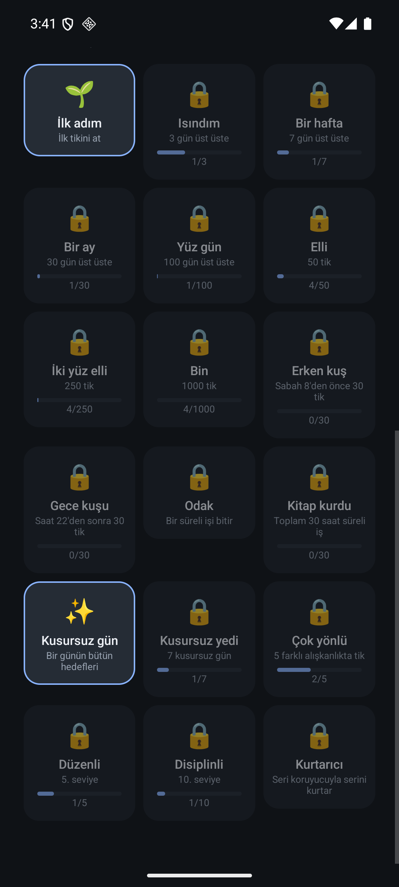
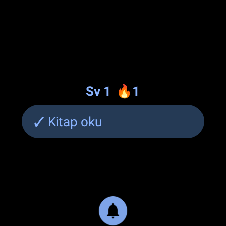
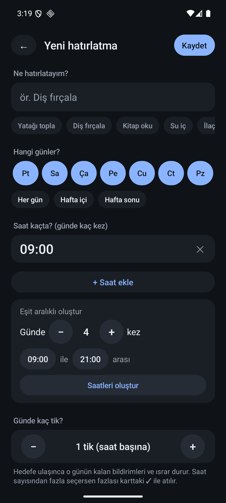
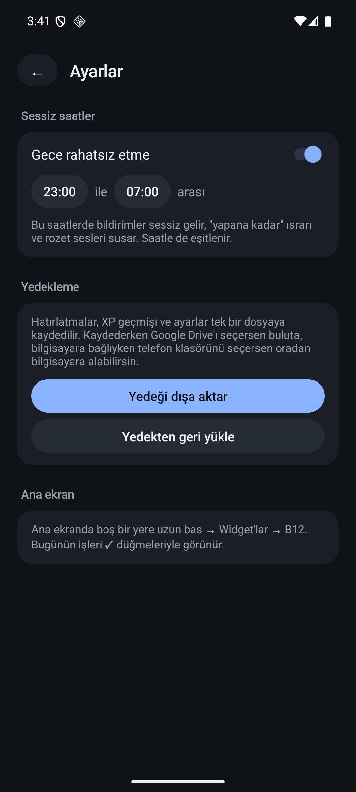

<h1 align="center">🔔 B12</h1>

<p align="center">Telefon ve <b>Galaxy Watch</b> için kalıcı hatırlatma ve alışkanlık uygulaması.<br>
Yatağı topla, diş fırçala, 1 saat kitap oku… Yaptıkça XP kazan, seviye atla, serini koru.</p>

<p align="center"><b><a href="CHANGELOG.md">📋 Sürümlerde neler var?</a></b></p>

<p align="center">
  
  
  
</p>

## İndir ve kur

B12 iki parçadır: **telefon uygulaması** ve **saat uygulaması**. Yalnız telefonu kurup kullanabilirsin; saatte de görmek istersen ikisini de kur. İkisi de aynı sürümden olmalı.

### 📱 Telefona kurulum

#### [⬇ B12-telefon.apk'yı indir](https://github.com/Sefikak/B12/releases/latest/download/B12-telefon.apk)

1. Yukarıdaki bağlantıya **telefondan** dokun, dosya inecek.
2. İnen dosyaya dokun. Telefon *"Bu kaynaktan uygulama yüklemeye izin ver"* derse **Ayarlar**'a gir, izni aç ve geri dön, sonra **Yükle**'ye bas.
   > Play Store dışından kurulduğu için Play Protect "tanınmayan uygulama" diyebilir: **Yine de yükle**'ye bas.
3. B12'yi aç, **bildirim iznini ver** (vermezsen hatırlatmalar görünmez).
4. Samsung'daysan ana ekranda çıkan **"Kısıtlamayı kaldır"** uyarısına dokun ve **İzin ver** de. Bunu yapmazsan Samsung'un pil tasarrufu uygulamayı uyutup hatırlatmaları geciktirebilir.

**Gereksinimler:** Android 8.0 veya üstü.

### ⌚ Saate kurulum (Galaxy Watch / Wear OS)

#### [⬇ B12-saat.apk'yı indir](https://github.com/Sefikak/B12/releases/latest/download/B12-saat.apk)

Saatte dosya açma özelliği olmadığı için ilk kurulum **bir kereliğine bilgisayardan, Wi-Fi üzerinden** yapılır. Sonraki sürümleri saat kendisi indirir (aşağıya bak). Toplam 5 dakika sürer.

**Hazırlık (bilgisayarda):**
1. [Android SDK Platform Tools](https://developer.android.com/tools/releases/platform-tools)'u indir (Windows için *"Download SDK Platform-Tools for Windows"*) ve zip'i bir klasöre çıkar, örneğin `C:\platform-tools`. İçinde `adb.exe` var.
2. `B12-saat.apk`'yı bilgisayara indir ve aynı klasöre koy.
3. O klasörde adres çubuğuna `cmd` yazıp Enter'a bas, bir komut penceresi açılır.

**Saatte geliştirici seçeneklerini aç:**
1. **Ayarlar → Saat hakkında → Yazılım → Yazılım sürümü**'ne art arda **5 kez** dokun. *"Geliştirici modu açıldı"* yazar.
2. **Ayarlar → Geliştirici seçenekleri**'ne gir, **ADB hata ayıklama**'yı aç.
3. Aynı yerde **Kablosuz hata ayıklama**'yı aç. Saat ve bilgisayar **aynı Wi-Fi ağında** olmalı.

**Eşle ve kur:**
1. Saatte **Kablosuz hata ayıklama → Yeni cihaz eşle**'ye dokun. Ekranda bir **6 haneli kod** ve bir **adres** (örneğin `192.168.1.35:37891`) çıkar.
2. Bilgisayardaki komut penceresine kendi kodunu ve adresini yazarak:
   ```
   adb pair 192.168.1.35:37891 123456
   ```
   *"Successfully paired"* yazarsa tamam. (Kod kısa sürede değişir; değiştiyse yenisini kullan.)
3. Saatteki **Kablosuz hata ayıklama** ekranının en üstündeki adresi (eşleme adresinden **farklı** bir port, örneğin `192.168.1.35:43899`) kullanarak bağlan:
   ```
   adb connect 192.168.1.35:43899
   ```
4. Kur:
   ```
   adb install -r B12-saat.apk
   ```
   *"Success"* yazınca B12 saatin uygulama listesinde. Açıp bildirim iznini ver.
5. İş bitti; pil yemesin diye saatte **Kablosuz hata ayıklama**'yı kapatabilirsin.

**Gereksinimler:** Wear OS 3 veya üstü (Galaxy Watch4 ve sonrası).

> Telefon ve saat birbirini **Bluetooth üzerinden** kendiliğinden bulur; ek bir ayar, internet ya da hesap gerekmez. Telefonda üstte *"⌚ Saat bağlı · eşitleniyor"* yazıyorsa eşleşmişlerdir.

<details>
<summary><b>Sorun mu var?</b></summary>

- **`adb` bulunamadı:** komut penceresini `adb.exe`'nin olduğu klasörde açtığından emin ol.
- **`pair` başarısız:** kod süresi dolmuş olabilir; saatte eşleme ekranını kapatıp yeniden aç, yeni kodu kullan. Bilgisayar ve saat aynı Wi-Fi'da mı bak (misafir ağları cihazları birbirinden ayırabilir).
- **`connect` başarısız:** eşleme adresini değil, Kablosuz hata ayıklama ekranının üstündeki adresi yaz. Ya da `adb mdns services` yaz; saat listede çıkıyorsa zaten bağlanmıştır, doğrudan `adb install` yap.
- **Telefon saati görmüyor:** iki uygulamanın da aynı sürüm olduğundan ve saatin Galaxy Wearable ile telefona bağlı olduğundan emin ol.
</details>

### 🔄 Güncellemeler

1.0.2'den itibaren B12 **kendini günceller**, telefonda da saatte de:

- Uygulama açılınca yeni sürüm var mı diye bakar.
- Varsa telefonda ana ekranda **"⬆ Yeni sürüm hazır · Güncelle"** şeridi, saatte en üstte **"⬆ … güncellemesi"** düğmesi çıkar.
- Dokununca yenilikleri gösterir, indirir, dosyanın bozulmadığını denetler ve Android'in yükleme ekranını açar.
- İlk seferde Android *"Bu kaynaktan yüklemeye izin ver"* diye sorar: izni açıp geri dönünce indirme kendiliğinden başlar.
- Hatırlatmaların, XP'n ve serin **korunur**.

Telefonda **Ayarlar → Güncelleme → Şimdi denetle** ile elle de bakabilirsin.

> 1.0 veya 1.0.1 kullanıyorsan güncelleyici o sürümlerde yok: **1.0.2'yi bir kez** yukarıdaki gibi elle kur (verilerin silinmez), sonrası kendiliğinden gelir.

## Özellikler

### Hatırlatmalar
- **Kalıcı hatırlatmalar:** ad, gün, günde istediğin kadar saat. Hazır öneriler: yatağı topla, diş fırçala, kitap oku, su iç, ilaç, spor
- **Ne sıklıkla:** seçili günler (her gün / hafta içi / hafta sonu / tek tek), **haftada X kez** ya da **tek seferlik** (tarih seç)
- **Saat üret:** "günde 5 kez, 09:00–21:00 arası" ya da "her 2 saatte bir"
- **Günde kaç tik:** örneğin 3 bildirim gelsin ama 2 tik yeterli olsun; hedef dolunca o günün kalan bildirimleri susar
- **Yapana kadar hatırlat:** bildirim ✓ diyene kadar kalır; kaydırıp kapatırsan seçtiğin süre (5/10/15/30/60 dk) sonra geri gelir
- **Süre:** "1 saat kitap oku" gibi işlerde bildirimde **Başla** çıkar, süre bitince haber verir
- **Not ve alt adımlar:** "Spor" içinde şınav, mekik, koşu… hepsini işaretleyince tik kendiliğinden atılır
- **Sessiz saatler:** örneğin 23:00–07:00 arası bildirimler sessiz, ısrar yok
- Bildirimde **Yaptım ✓**, **Ertele**, **Başla**; birinde basınca öbür cihazdan da kalkar

### Galaxy Watch
- Saatte ekleme, düzenleme ve silme; ad için klavye ya da sesle yazma, saat seçmek için **döner çerçeve**
- **Telefondan uzaktayken de** saat kendi alarmını çalar
- Ayrıyken yapılan değişiklikler bağlantı gelince eşitlenir; aynı işe iki cihazda basılsa da bir kez sayılır
- **Saat kartı (Tile):** kaydırınca bugünün işleri, dokununca tik
- **Kadran göstergesi:** kadranda "2/3 · 🔥5" ya da bugünün ilerleme halkası

<p align="center">
  
  
</p>

### XP, seviye ve rozetler
- Her tik **XP** kazandırır: zamanında yaparsan, süreli işi bitirirsen ve serini sürdürürsen ek puan
- **Seviyeler ve unvanlar:** Çaylak → Isınıyor → Düzenli → Kararlı → Disiplinli → Alışkanlık Canavarı → Usta → B12 Efsanesi
- **🔥 Günlük seri** ve alışkanlık başına seri
- **🧊 Seri koruyucu:** her 7 günlük seride 1 tane (en çok 2); bir gün kaçırırsan serin bozulmaz
- **18 rozet:** Bir hafta, Bir ay, Erken kuş, Gece kuşu, Kitap kurdu, Kusursuz gün…
- **İstatistik:** 16 haftalık ısı haritası, haftalık XP grafiği, alışkanlık başına son 30 gün oranı

### Diğer
- **Ana ekran widget'ı:** bugünün işleri ✓ düğmeleriyle
- **Yedekleme:** tek dosyaya dışa aktar / geri yükle; kaydederken Google Drive'ı seçersen buluta gider
- Koyu tema, Türkçe arayüz

<p align="center">
  
  
</p>

## Gizlilik

B12 hesap istemez, veri toplamaz. Her şey telefonunda ve saatinde durur; ikisi arasındaki eşitleme Bluetooth üzerinden Wear OS'un kendi kanalıyla yapılır. İnternete yalnızca yeni sürüm var mı diye GitHub'a bakmak ve güncellemeyi indirmek için çıkar; senden hiçbir bilgi göndermez.

## Geliştirme

Kotlin, Android Gradle Plugin 8.13, compileSdk 36. Modüller:

| Modül | İçerik |
|---|---|
| `shared` | Hatırlatma modeli, depolama, alarmlar, bildirimler, XP/rozetler, telefon↔saat eşitlemesi |
| `app` | Telefon uygulaması (minSdk 26), widget |
| `wear` | Saat uygulaması (minSdk 30), Tile, kadran göstergesi |

Derleme: `build.bat` (debug) ya da `build.bat release` → `B12-telefon.apk`, `B12-saat.apk`.
İmza anahtarı `keystore/` klasöründedir ve depoda yoktur. Telefon ve saat uygulaması **aynı anahtarla** imzalanmalıdır, yoksa birbirini görmez.
